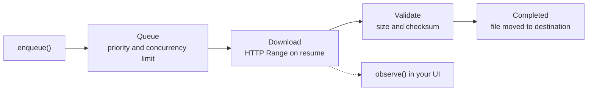

<p align="center">
  
</p>

# KMP File Downloader

### A resumable file downloader library for Kotlin Multiplatform: Android, iOS and Desktop

<!-- Add after the first release:
[](https://central.sonatype.com/artifact/io.github.agohil29/kmp-file-downloader)
-->
[](LICENSE)


> **Status: early release (0.1.x).** The API may still change between minor versions.
> See [Known limitations](#known-limitations).

<table>
  <tr>
    <td align="center"><b>Android</b></td>
    <td align="center"><b>iOS</b></td>
    <td align="center"><b>Desktop</b></td>
  </tr>
  <tr>
    <td></td>
    <td></td>
    <td></td>
  </tr>
</table>

# About KMP File Downloader

KMP File Downloader lets you download large files from shared Kotlin code, with the same API on
every platform. It keeps a persistent queue, resumes interrupted transfers with HTTP `Range`
requests, verifies what it downloaded, and only puts a finished, validated file in its final
location.

# Why use KMP File Downloader

- Works on Android, iOS and Desktop (JVM) from one `commonMain` API.
- Pause and resume using HTTP `Range` with `If-Range` validators, so a changed file is never spliced.
- Downloads survive app restarts: the queue and progress are stored in SQLDelight.
- Priorities, a concurrency limit and download groups (pause, resume or cancel a whole group).
- Checksum validation (MD5, SHA-1, SHA-256) before the file is committed.
- Safe writes: bytes go to a staging `.part` file and are moved into place atomically.
- Conflict strategies when the target file already exists (overwrite, rename, fail).
- Reactive progress and speed through Kotlin `StateFlow` and `Flow`.
- Android: foreground service, progress notification and WorkManager integration.
- iOS: background `NSURLSession` with resume data, so transfers continue while the app is suspended.
- Modular: use the whole runtime, or just the parts you need.

<p align="center">
  
</p>

# How to use KMP File Downloader

## Installation

```kotlin
// build.gradle.kts of your shared module
kotlin {
    sourceSets {
        commonMain.dependencies {
            implementation("io.github.agohil29:kmp-file-downloader:0.1.0")
        }
    }
}
```

The runtime artifact brings in the core, storage, network and filesystem modules, so you do not
need to add them separately. You do need a **Ktor HTTP engine** for each platform you target:

```kotlin
androidMain.dependencies { implementation("io.ktor:ktor-client-okhttp:<ktor-version>") }
iosMain.dependencies     { implementation("io.ktor:ktor-client-darwin:<ktor-version>") }
desktopMain.dependencies { implementation("io.ktor:ktor-client-cio:<ktor-version>") }
```

Use the same Ktor version as the library (currently **3.1.0**).

Requirements: Android `minSdk` 24, JVM 17 or newer, Kotlin 2.1 or newer.

## Usage

### 1. Create the downloader

There is no one-line factory yet. You build a `DefaultFileDownloader` from four parts: a config,
a repository, a network transport and a file system. Keep a **single instance** per app.

**Desktop**

```kotlin
val database = createDownloadDatabase(
    DatabaseDriverFactory(dbFile = File(System.getProperty("user.home"), ".myapp/downloads.db"))
)

val downloader: FileDownloader = DefaultFileDownloader(
    config = DownloaderConfig(
        maxConcurrentDownloads = 3,
        stagingDirectory = "/path/to/staging".toPath()
    ),
    repository = SqlDelightDownloadRepository(database),
    network = KtorNetworkTransport(HttpClient(CIO)),
    fileSystem = OkioDownloadFileSystem()
)
```

`DatabaseDriverFactory()` with no file uses an in-memory database, so history is lost on exit.

**Android**

```kotlin
val database = createDownloadDatabase(DatabaseDriverFactory(context))

val downloader: FileDownloader = DefaultFileDownloader(
    config = DownloaderConfig(stagingDirectory = context.cacheDir.absolutePath.toPath()),
    repository = SqlDelightDownloadRepository(database),
    network = KtorNetworkTransport(HttpClient(OkHttp)),
    fileSystem = OkioDownloadFileSystem()
)
```

**iOS**

Same pattern with `HttpClient(Darwin)` and `DatabaseDriverFactory()`. To keep downloads running
while the app is suspended, pass an `IosBackgroundSessionBridge` as `backgroundEngine`. See
[iOS integration](docs/runtime/ios-integration.md).

### 2. Download a file

```kotlin
val id = downloader.enqueue(
    DownloadRequest(
        url = "https://example.com/big-file.zip",
        destinationDirectory = downloadsDir,          // okio.Path
        fileName = "big-file.zip",                    // optional; derived from the URL if omitted
        priority = DownloadPriority.HIGH,
        conflictStrategy = ConflictStrategy.RENAME_NEW_INCREMENTAL,
        expectedChecksum = ChecksumValidation(ChecksumValidation.Algorithm.SHA256, "<hex>"),
        group = "assets"                              // optional
    )
)

downloader.observe(id).collect { state ->
    when (state) {
        is DownloadState.Downloading -> println("${state.progressPercentage}% at ${state.speedBytesPerSecond} B/s")
        is DownloadState.Completed   -> println("Saved to ${state.absolutePath}")
        is DownloadState.Failed      -> println("Failed: ${state.error.message} (retry: ${state.canRetry})")
        is DownloadState.Paused      -> println("Paused at ${state.downloadedBytes} bytes")
        else -> Unit
    }
}
```

`observe` returns a `StateFlow<DownloadState>`. See the [state diagram](#download-states) below.

### 3. Control downloads

```kotlin
downloader.pause(id)                      // keeps the partial file for resuming
downloader.resume(id)                     // continues with an HTTP Range request
downloader.retry(id)                      // retry a failed download
downloader.cancel(id)
downloader.delete(id, deleteFiles = true)

downloader.pauseGroup("assets")
downloader.resumeGroup("assets")
downloader.cancelGroup("assets")

downloader.observeAll()                   // Flow<List<DownloadState>> for a download list UI
downloader.shutdown()                     // on app termination
```

After a process restart, downloads that were in flight come back as `Paused` and can be resumed.

#### Important Note 1: Android

The library manifest declares `INTERNET`, `ACCESS_NETWORK_STATE`, `FOREGROUND_SERVICE`,
`FOREGROUND_SERVICE_DATA_SYNC` and `POST_NOTIFICATIONS`, so they are merged into your app. Request
`POST_NOTIFICATIONS` at runtime on Android 13+. Use `WorkManager.enqueueBackgroundDownload(...)` for
work that should survive the app being closed. Details:
[Android notifications and WorkManager](docs/android/android-notifications-and-workmanager.md).

#### Important Note 2: iOS

Enable the background modes your app needs in `Info.plist`, and forward
`handleEventsForBackgroundURLSession` from your `AppDelegate` to `IosAppDelegateHelper.shared`.
Details: [iOS integration](docs/runtime/ios-integration.md).

#### Desktop

`DesktopPathResolver` gives sensible default download and database folders, and `DesktopShutdownHook`
lets you flush state when the JVM exits.

## Customisation

`DownloaderConfig` controls the engine:

```kotlin
DownloaderConfig(
    maxConcurrentDownloads = 3,        // how many transfers run at once
    stagingDirectory = stagingPath,    // where .part files are kept
    connectTimeoutMs = 15_000L,
    readTimeoutMs = 30_000L,
    progressUpdateIntervalMs = 100L    // how often progress is emitted and saved
)
```

Each `DownloadRequest` can set `priority`, custom `headers` (for example an `Authorization` header),
`conflictStrategy`, `expectedChecksum` and a `group`.

# How it works



Bytes are written to a staging `.part` file and moved to the destination only after validation. When
a download is resumed, the library asks the server for the remaining bytes (`Range` with `If-Range`).
If the file changed or the server cannot continue, it restarts from the beginning instead of mixing
two versions. The checksum, when requested, is computed over the complete file. More detail in
[HTTP range / resume](docs/engine/http-range-resume.md) and the
[architecture overview](docs/architecture/overview.md).

States: `Idle`, `Queued`, `Connecting`, `Downloading`, `Paused`, `Validating`, `Completed`,
`Failed` and `Cancelled`.

# Modules

| Module                  | Role                                                              |
|-------------------------|-------------------------------------------------------------------|
| `downloader-core`       | Public API, models, state machine, scheduler, download engine     |
| `downloader-network`    | Ktor-based `NetworkTransport`                                     |
| `downloader-filesystem` | Okio-based file system, staging and atomic moves                  |
| `downloader-storage`    | SQLDelight persistence                                            |
| `downloader-runtime`    | `DefaultFileDownloader` plus Android, iOS and Desktop integration |

Published artifacts: `kmp-file-downloader` (runtime), `kmp-file-downloader-core`,
`-network`, `-filesystem` and `-storage`. More in the
[architecture overview](docs/architecture/overview.md).

# Known limitations

- There is no one-call factory yet; you assemble DefaultFileDownloader yourself (see above).
- The **Pause** and **Cancel** buttons on the Android download notification are not wired up yet.
  Use `pause` / `cancel` on the downloader instance instead.
- On iOS, ETag and Last-Modified are not recorded; resuming relies on the resume data iOS provides.
- The public API may change before 1.0.

# Building and testing

```
./gradlew desktopTest            # common and desktop tests
./gradlew iosSimulatorArm64Test  # on macOS
```

Sample apps for Android, iOS and Desktop are in [`samples/`](samples/).

## Contribute to the project

Issues and pull requests are welcome. Please run the tests before submitting.

## Contact Me

[LinkedIn](https://www.linkedin.com/in/arun-gohil-210427187/)

## If this project helps you, show love

Give the repository a star on GitHub.

## License

Licensed under the [Apache License, Version 2.0](LICENSE).

```
Copyright 2026 Arun Gohil

Licensed under the Apache License, Version 2.0 (the "License");
you may not use this file except in compliance with the License.
You may obtain a copy of the License at

    http://www.apache.org/licenses/LICENSE-2.0

Unless required by applicable law or agreed to in writing, software
distributed under the License is distributed on an "AS IS" BASIS,
WITHOUT WARRANTIES OR CONDITIONS OF ANY KIND, either express or implied.
See the License for the specific language governing permissions and
limitations under the License.
```
